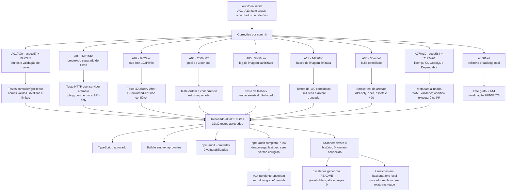
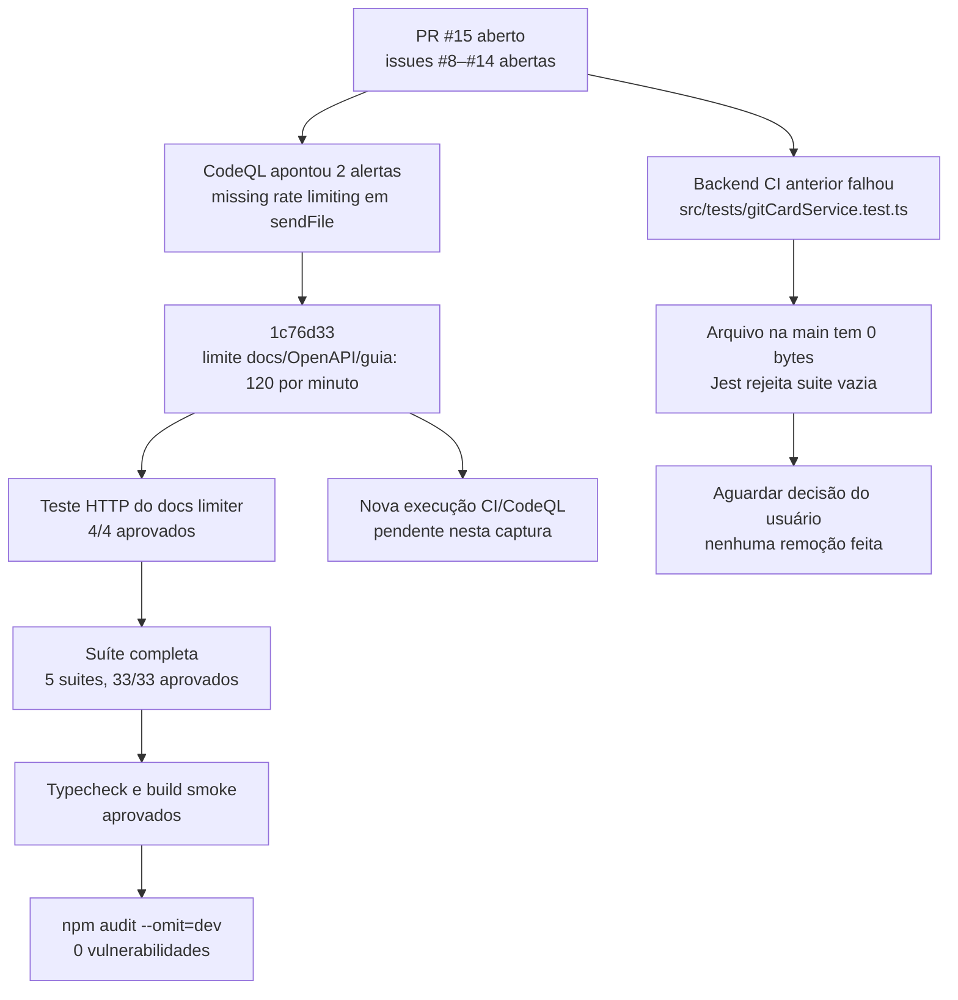
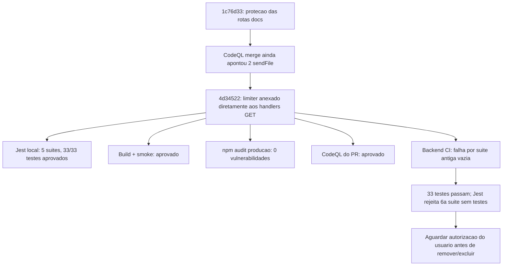
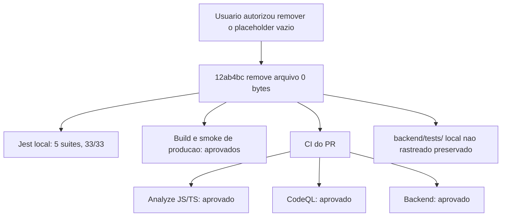

# Grafo de evolução e resultados da auditoria

Data de atualização: 28/10/2026. Fonte: auditoria técnica e grafo de riscos recebidos.

## Leituras do grafo

- O relatório de entrada indicava lacunas, mas não havia evidência de testes rodados. As mudanças foram separadas em commits; cada grupo foi associado ao cenário que o protege.
- Revalidação local em 28/10: Jest 5/5 suites e 32/32 testes; typecheck; smoke do build; audit de produção sem vulnerabilidades.
- O audit completo passou a sinalizar 7 vulnerabilidades baixas via deepmerge 4.3.1 na árvore de desenvolvimento do Jest. O advisory GHSA-gcqx-w48m-w2h4/CVE-2026-93753 ainda não lista versão corrigida. O usuário escolheu aguardar upstream; npm audit --force recomenda downgrade do Jest, então não foi aplicado.
- O scanner local encontrou zero padrões de credencial conhecidos na árvore versionável e no histórico alcançável. Os seis matches genéricos do README histórico são placeholders. Dois matches existem somente em backend/.env ignorado; nenhum arquivo .env exato está rastreado. Isso é uma varredura por padrões, não certificação.
- A07/A10: CI/CodeQL/Dependabot estão no branch; os workflows hospedados dependem de push/PR. Secret Scanning/Push Protection precisam de confirmação nas configurações do repositório.

## Estado remoto em 28/10/2026

Issues #8–#14 foram criadas no repositório; os links e o conteúdo detalhado estão em ISSUES_PENDENTES.md. A publicação do branch e a abertura do PR são a próxima etapa após os testes desta atualização.
## Evolução após a abertura do PR #15 — 28/10/2026

O CodeQL apontou duas rotas que enviam arquivos da documentação sem rate limit. O commit 1c76d33 adicionou um limite separado de 120/minuto, compartilhado entre /docs, /swagger.yaml e o guia, com erro DOCS_RATE_LIMITED e Retry-After. O novo teste HTTP verifica o limite entre rotas.

O job backend falhou no checkout público porque backend/src/tests/gitCardService.test.ts tem zero bytes na main e o Jest rejeita uma suite vazia. O worktree já mostrava esse arquivo como removido antes desta correção. Mantive-o fora dos commits e estou aguardando a autorização solicitada antes de remover ou excluir esse teste da descoberta do Jest.

PR: [#15](https://github.com/SamuelBProenca/OctoCards/pull/15). Issues: [#8–#14](https://github.com/SamuelBProenca/OctoCards/issues).

## Revalidacao final do PR #15 - 28/10/2026

O commit 4d34522 liga o rate limiter explicitamente aos handlers de /swagger.yaml e /GUIA_DO_OCTOCARDS.md. Validacao local: 33/33 testes, build e smoke aprovados; auditoria de producao sem vulnerabilidades. O check CodeQL remoto passou. O check backend permanece falhando porque a main publica inclui backend/src/tests/gitCardService.test.ts vazio; 5 suites passaram e 33 testes passaram, mas Jest falha na sexta suite. Nenhum teste foi apagado ou excluido da descoberta; aguardando a decisao solicitada.
## Resolucao da suite vazia - 28/10/2026

Estado final: o placeholder nao continha testes em nenhum commit historico; o arquivo foi adicionado vazio em 26/02/2025. A suite real gitCardService.test.ts permanece em src/services com 12 casos. Apos a remocao aprovada, os testes locais e o build/smoke passaram e os tres checks remotos do PR passaram. A pasta local backend/tests/ continuou fora do commit.