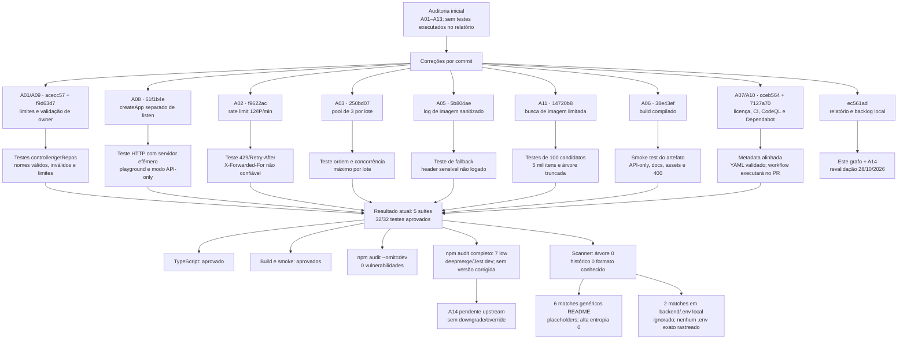

# Grafo de evolução e resultados da auditoria

Data de atualização: 28/10/2026. Fonte: auditoria técnica e grafo de riscos recebidos.

## Leituras do grafo

- O relatório de entrada indicava lacunas, mas não havia evidência de testes rodados. As mudanças foram separadas em commits; cada grupo foi associado ao cenário que o protege.
- Revalidação local em 28/10: Jest 5/5 suites e 32/32 testes; typecheck; smoke do build; audit de produção sem vulnerabilidades.
- O audit completo passou a sinalizar 7 vulnerabilidades baixas via deepmerge 4.3.1 na árvore de desenvolvimento do Jest. O advisory GHSA-gcqx-w48m-w2h4/CVE-2026-93753 ainda não lista versão corrigida. O usuário escolheu aguardar upstream; npm audit --force recomenda downgrade do Jest, então não foi aplicado.
- O scanner local encontrou zero padrões de credencial conhecidos na árvore versionável e no histórico alcançável. Os seis matches genéricos do README histórico são placeholders. Dois matches existem somente em backend/.env ignorado; nenhum arquivo .env exato está rastreado. Isso é uma varredura por padrões, não certificação.
- A07/A10: CI/CodeQL/Dependabot estão no branch; os workflows hospedados dependem de push/PR. Secret Scanning/Push Protection precisam de confirmação nas configurações do repositório.

## Estado remoto em 28/10/2026

Issues #8–#14 foram criadas no repositório; os links e o conteúdo detalhado estão em ISSUES_PENDENTES.md. A publicação do branch e a abertura do PR são a próxima etapa após os testes desta atualização.